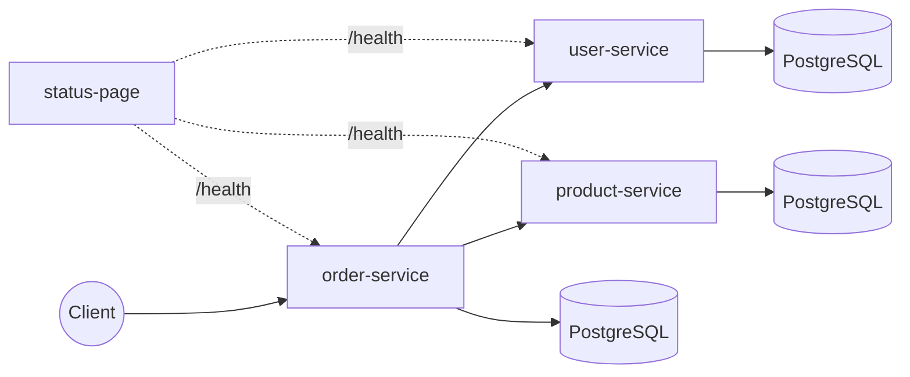
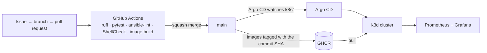

# km1 — DevOps Learning Project

[](https://github.com/ryslaw/km1/actions/workflows/ci.yml)

A small e-commerce-style microservices system used as a hands-on playground for building DevOps skills: containerization, CI/CD, configuration management, infrastructure as code, Kubernetes, and observability — layered incrementally on top of an existing application.

**Status:** actively developed since September 2026 — currently in
[Phase 9: Ansible on real Linux hosts](https://github.com/ryslaw/km1/milestone/10).
Every change is tracked as an [issue](https://github.com/ryslaw/km1/issues?q=is%3Aissue) and delivered through a
[pull request](https://github.com/ryslaw/km1/pulls?q=is%3Apr+is%3Amerged).

## What this project demonstrates

- **Continuous Integration** — every pull request runs ruff, pytest across a four-service matrix, ansible-lint,
  ShellCheck and the container image builds; images are pushed to GHCR from `main` only, tagged with the commit SHA.
- **GitOps** — Argo CD syncs `k8s/` from `main`; deploying a new version means changing an image tag in a pull
  request, with no `kubectl` command.
- **Kubernetes** — a k3d cluster with Traefik Ingress, liveness and readiness probes, and chaos endpoints for
  drilling database outages.
- **Observability** — Prometheus metrics in every service, ServiceMonitors, and a Grafana dashboard kept as code.
- **Infrastructure as Code & configuration management** — the stack on local Docker with Terraform; Ansible run from
  pinned versions against physical Ubuntu hosts, with user accounts and sudo rules managed as code.
- **Least privilege** — separate admin, operator, auditor and automation accounts with a documented
  [access model](docs/access-model.md), and job-level token permissions in CI.

## Architecture

Four Python services, each independently containerized:



| Service | Description | Depends on |
|---|---|---|
| `user-service` | User registration and lookup (Postgres-backed) | — |
| `product-service` | Product catalog with stock and reservation | — |
| `order-service` | Places orders: validates the user, reserves stock, computes total | `user-service`, `product-service` |
| `status-page` | Dashboard polling `/health` on the three services above | all of the above |

The endpoints of each service (`/health`, `/livez`, `/metrics`, `/chaos/*`) are described in
[services/README.md](services/README.md#endpoints).

## Delivery pipeline



## Tech stack

- **Language/framework:** Python 3.12, FastAPI, SQLAlchemy
- **Database:** PostgreSQL
- **Containerization:** Docker, Docker Compose
- **CI:** GitHub Actions
- **Configuration management / IaC:** Ansible, Terraform
- **Orchestration:** Kubernetes (k3d, Traefik Ingress)
- **Monitoring:** Prometheus, Grafana (kube-prometheus-stack, Helm)
- **GitOps:** Argo CD (Helm)

## Quick start

Requires Docker with the Compose plugin (`docker compose version`).

```
cp .env.example .env    # then fill in your own values
docker compose up --build
```

Open the status dashboard at http://localhost:8000 once all containers report healthy. Debug ports, stopping the
stack and the other ways to run it are described in [Running locally](services/README.md#running-locally) and the
documents below.

## Documentation

Each area is documented next to its code. Run all commands from the repo root unless a document says otherwise.

| Area | Document | What it covers |
|---|---|---|
| Services | [services/README.md](services/README.md) | Endpoints, running the stack with Docker Compose |
| Development | [docs/development.md](docs/development.md) | Linting, testing, CI, container images in GHCR |
| Terraform | [terraform/README.md](terraform/README.md) | The same stack on local Docker, managed with Terraform |
| Kubernetes | [k8s/README.md](k8s/README.md) | The k3d cluster, deploying a new version, pulling from GHCR, probes and chaos drills |
| Monitoring | [monitoring/README.md](monitoring/README.md) | Prometheus and Grafana (kube-prometheus-stack, `helm/kube-prometheus-stack/`), the km1 dashboard |
| GitOps | [argocd/README.md](argocd/README.md) | Argo CD (`helm/argo-cd/`) and the km1 Application |
| Ansible | [ansible/README.md](ansible/README.md) | Setup, inventory, the physical hosts, the Compose playbook, linting |
| Ansible role `users` | [ansible/roles/users/README.md](ansible/roles/users/README.md) | Role variables, removing accounts and sudo rules |
| Access model | [docs/access-model.md](docs/access-model.md) | Who has which rights on the physical hosts, and why |

## Roadmap

This project is developed phase by phase, each tracked as a
[GitHub Milestone](https://github.com/ryslaw/km1/milestones?state=all) with issues (✅ = done, 🚧 = in progress):

0. ✅ Git/GitHub project foundation
1. ✅ Docker Compose (all services running together locally)
2. ✅ Code quality & automated testing baseline
3. ✅ Continuous Integration (GitHub Actions)
4. ✅ Configuration management with Ansible
5. ✅ Infrastructure as Code with Terraform (local)
6. ✅ Kubernetes deployment
7. ✅ Observability (metrics & dashboards)
8. ✅ GitOps & continuous delivery (Argo CD, container images in GHCR)
9. 🚧 Configuration management II: Ansible on real Linux hosts (roles, Vault, testing; a multi-node k3s cluster)
10. Automation platform: AWX
11. Packaging & workload security (a Helm chart for km1, image scanning, pod hardening, per-service database roles)
12. Cloud foundation: Google Cloud with Terraform (remote state, IAM, networking, keyless CI)
13. Kubernetes in the cloud: km1 on GKE (managed secrets, network policies)
14. CI/CD across platforms (GitLab CI, Cloud Build and Cloud Deploy, Jenkins)
15. Operations & SRE on GKE (SLOs, alerting, logging)

Throughout all phases: least privilege on every layer, both for people (admin, operator, developer and auditor roles) and for applications and automation (a dedicated technical account per application, pipeline and tool), and troubleshooting drills on deliberately broken scenarios.

## How I work

- Every change starts as an issue (see `.github/ISSUE_TEMPLATE/`) assigned to a phase milestone.
- Each issue gets its own branch and pull request (see `.github/PULL_REQUEST_TEMPLATE.md`); `main` accepts changes
  only through pull requests that pass CI, merged with squash.
- Commit messages follow [Conventional Commits](https://www.conventionalcommits.org/).
- A change that touches an area also updates that area's document from the [documentation map](#documentation).

## About AI assistance

This project is built with an AI assistant (Claude) as a mentor. The application in `services/` is only the workload
the infrastructure runs, and its code is AI-generated. The infrastructure, automation and CI/CD code (Docker,
GitHub Actions, Ansible, Terraform, Kubernetes, Helm, Argo CD) is written by me, with the assistant reviewing it,
giving hints and pointing to documentation. The documentation is drafted with AI assistance.

## License

[MIT](LICENSE)
